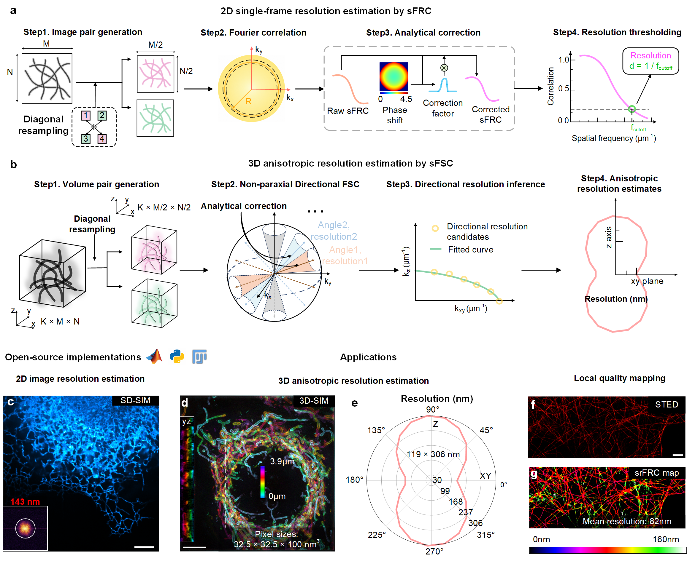

# srFRCm

MATLAB implementation of the single-acquisition sFRC/sFSC resolution-estimation framework.

## Publication

This repository accompanies the manuscript:

> **Single-acquisition estimation of anisotropic 3D resolution in super-resolution fluorescence microscopy**

Final bibliographic information and DOI will be added after publication.

**Other implementations:** [Fiji/ImageJ / srFRCj](https://github.com/SR-Wiki/srFRCj) · [Python / srFRCpy](https://github.com/SR-Wiki/srFRCpy)

[Introduction](#introduction) · [Installation](#installation) · [Demo scripts](#demo-scripts) · [Basic parameters](#basic-parameters) · [Version](#version) · [Resources](#resources) · [License](#license)

> **Note:** This is the first public release. Some rough edges may still be expected. If you encounter any issues or unexpected behavior, please [open an issue](https://github.com/SR-Wiki/srFRCm/issues).

## Introduction

Effective resolution in fluorescence microscopy depends on the sample, fluorophores, acquisition conditions and reconstruction procedure, creating a need for direct resolution assessment from acquired data. Fourier ring correlation (FRC) and Fourier shell correlation (FSC) provide image-based resolution estimates from the highest spatial frequencies shared by two observations, but repeated fluorescence acquisitions can be compromised by sample dynamics, photobleaching, drift and acquisition variability.

Three-dimensional fluorescence imaging presents an additional challenge because optical resolution is anisotropic, voxel spacings and array dimensions commonly differ across axes, and sequential z-stack acquisition can introduce inter-slice inconsistencies. These effects make direct axial-resolution estimation particularly sensitive to paraxial Fourier artifacts and acquisition-dependent changes.

The framework addresses these problems with **single-frame FRC (sFRC)** and **single-volume FSC (sFSC)**. sFRC generates two complementary observations from one 2D image by exploiting local spatial redundancy and point-spread-function symmetry, followed by an analytical frequency-domain correction for the deterministic bias introduced by diagonal resampling. sFSC extends the same single-acquisition principle to 3D volumes and introduces **directional resolution inference (DRI)**, which estimates axial resolution from reliable non-paraxial directional FSC information while accommodating anisotropic resolution and unequal sampling. The framework is further extended to spatially resolved analysis through **srFRC**.

<p align="center">

</p>

## Installation

### Tested platform
  - Windows 10, MATLAB R2022b

### Requirements

The current MATLAB implementation uses functions from:

- **Image Processing Toolbox** (`imresize`, `graythresh`, `imfilter`, `imgaussfilt`, `padarray`, etc.);
- **Curve Fitting Toolbox** (`fit`, `fittype`, `fitoptions`) for FRC/FSC curve extrapolation and related fitting routines;
- **Mapping Toolbox** for the current use of `roundn` in plotting/display code.

Some optional srFRC/helper routines also use parallel or GPU functionality; **Parallel Computing Toolbox** is therefore recommended when using those functions.

### Setup

Clone or download the repository and add the top-level source, utility and demo folders to the MATLAB path:

```matlab
git clone https://github.com/SR-Wiki/srFRCm.git
root='path/to/srFRCm';
addpath(fullfile(root,'src')); addpath(fullfile(root,'src/Utils')); addpath(fullfile(root,'src/fSNR'));
```

You can optionally save the path for future MATLAB sessions:

```matlab
savepath;
```

The three main implementations live together in `src/`. The `demos/` folder
contains exactly three runnable examples: `sFRC_demo.m`, `sFSC_demo.m` and
`srFRC_demo.m`. All plotting, saving and other helper functions live in `utils/`.


## Demo scripts

Download and extract the **example_data.zip** asset from
[srFRCj Releases](https://github.com/SR-Wiki/srFRCj/releases/download/v1.0/example_data.zip) into the project-root
`example_data/`, alongside `src/`, `utils/` and `demos/`. The demos directly read
`Fig2b_SD-SIM.tif` (sFRC), `Fig2h.tif` (srFRC), and `Fig4i_1.tif` / `Fig4i_2.tif`
(single/paired sFSC). Edit the explicit path and calibrated pixel size in each
demo if your files differ. No extra data-loader function is required.

The core functions receive image arrays and return numerical results. Saving
is a separate demo step. Outputs go directly into **current-working-directory
`results/`**, using module/stage names such as `sFRC_results.csv` and
`srFRC_bg1.2_resolution-map.tif`. There are no timestamped run folders or
input-base-name settings; repeating a run overwrites same-named outputs.
The demo's plot/save switches are at the top of the script. Saving disabled
means no output files or directories; plotting disabled still allows numeric export.

```matlab
addpath('demos');
sFRC_demo;
sFSC_demo;
srFRC_demo;
```

Run from the desired working directory so its `results/` folder receives the
outputs. MATLAB sampling is in um; stacks use YXT and sFSC volumes YXZ with
spacing `[x,y,z]`. Plotting is demo-only and is not a core function parameter.

See [demo outputs](docs/advancedParameters.md#demo-outputs) for saved formats
and [advanced parameters](docs/advancedParameters.md) for the current policy.


## Input preparation and figures

Images are converted to single (float32) and divided by their maximum before analysis.
Stacks/volumes share one maximum to preserve relative slice intensities;
all-zero inputs stay zero. Result figures and saved previews omit diagnostic
text; warnings and E_DRI interpretation are printed to the console. Correlation
curves and fitted anisotropic profiles use light red (RGB 230,115,115).
See [input preparation details](docs/advancedParameters.md#input-precision-normalization-and-plot-appearance).

## Basic parameters

The analysis modes are listed below. Language-specific parameter names,
defaults, batching and result interpretation are documented in
[docs/advancedParameters.md](docs/advancedParameters.md). The help blocks of
the three main functions in `src/` describe the inputs and returned data.

### sFRC

| Parameter | Default / source | Description |
| --- | --- | --- |
| Pixel Size | image calibration or user input | Physical lateral sampling in um |
| If SingleFrame | `true` | Generates the complementary pair from one acquisition |

### sFSC

| Parameter | Default / source | Description |
| --- | --- | --- |
| Pixel Size (XY) | image calibration or user input | Physical lateral voxel spacing in um |
| Pixel Size (Z) | image calibration or user input | Physical axial voxel spacing in um |
| If SingleFrame | `true` | Enables single-volume pair generation |

### srFRC

| Parameter | Default / source | Description |
| --- | --- | --- |
| Block Size | `64` pixels | Local rolling-analysis window |
| Skip | `2` pixels | Step between neighboring rolling windows |
| Pixel Size | image calibration or user input | Physical lateral sampling in um |
| If SingleFrame | `true` | Uses single-frame pair generation for local analysis |

Advanced controls for **sFRC**, **sFSC/DRI**, and **srFRC** are documented separately in [docs/advancedParameters.md](docs/advancedParameters.md).

## Version

**v0.1.11**

## Resources

- [Advanced parameters](docs/advancedParameters.md)
- [Fiji/ImageJ implementation — srFRCj](https://github.com/SR-Wiki/srFRCj)
- [Python implementation — srFRCpy](https://github.com/SR-Wiki/srFRCpy)
- [srFRCJ Wiki](https://github.com/SR-Wiki/srFRCj/wiki/)
- [Related rolling-FRC publication](https://doi.org/10.1038/s41377-023-01321-0)

## License

## Open source [srFRC](https://github.com/SR-Wiki/srFRCm)
This software and corresponding methods can only be used for **non-commercial** use, and they are under Open Data Commons Open Database License v1.0.


